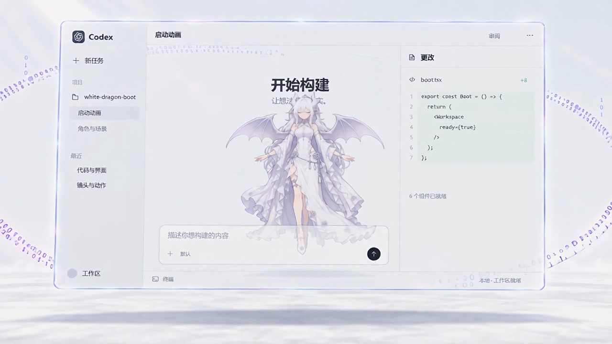
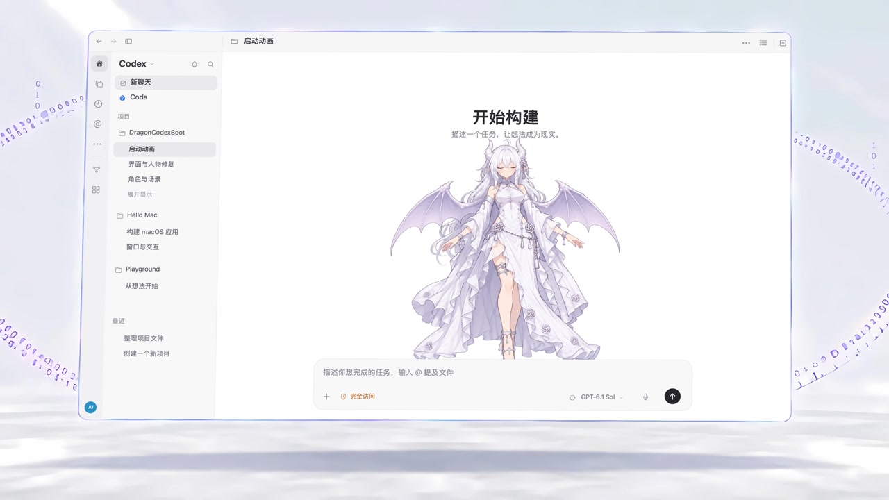

# 启动动画清晰度与白色 Codex 界面

原示例视频在人物缩小、进入模拟 Codex 窗口时，发丝和服装细节较软，界面中的中文与代码还存在变形笔画。这次只更新随附视频，让人物和界面文字更容易看清，并把末尾的模拟窗口改成更接近 Codex 的经典白色布局。

`media/startup.mp4` 仍是启动器使用的相对路径。启动器源码、默认窗口尺寸、播放逻辑、等待节点、交接时间和公开配置均未改变。现有构建与打包脚本会直接带上新视频，播放时不需要运行 AI、连接网络或安装新的依赖。

## 同一时间点的画面对比

以下两张图都取自相应 MP4 的 10.25 秒处，统一缩放为 1280 × 720，便于比较文字、人物和窗口布局。

原随附视频：

当前视频：

## 具体处理

前 9.5 秒采用 Real-ESRGAN 的动画插画修复模型整理人物轮廓、发丝和小装饰，再输出为 4K。后段重新绘制模拟界面中的中文和系统图标，使用顶部工具栏、窄导航栏、项目侧栏、宽聊天区与底部输入框的结构，去掉原来的虚构代码区。项目与聊天标题使用演示内容，不包含真实聊天记录。

后段人物以原片正面闭眼画面为参考，用 AI 编辑生成透明立绘，再合成缩小、轻微漂浮和淡出。为让人物在展示阶段保持可见，明显淡出延后至约 12.1 秒。窗口四角跟随原片的透视和放大过程，外部地面、数字轨道与原音轨保留。

这是有取舍的重绘：部分衣服花饰、发饰和脸部细节由 AI 推断，后段裙摆运动不再逐帧对应原片。它改善了可读性和细节表现，不能作为原作者未经压缩画稿的恢复记录。模拟界面仍属于视频内容。

## 文件规格与验证范围

| 项目 | 原随附视频 | 当前视频 |
| --- | --- | --- |
| 画面尺寸 | 1920 × 1080 | 3840 × 2160 |
| 帧率与帧数 | 24 fps，338 帧 | 24 fps，338 帧 |
| 文件时长 | 约 14.10 秒 | 约 14.10 秒 |
| 编码 | H.264 / AAC | H.264、`yuv420p` / 原 AAC 音轨 |
| 文件大小 | 22,937,247 字节 | 46,986,698 字节 |

原视频 SHA-256：`a322c9947e6486c887cdc0ba913bbe57476b230abf45d85d95d86bce3898cfcd`。

当前视频 SHA-256：`7519f4ea70c2efdfdd4791a8839ca039180bc46604992e6ef5308539a08b170d`。

已在 macOS 上对当前文件完成 338 帧完整解码，确认没有解码错误；原片与当前文件的 AAC 数据哈希一致。视觉检查覆盖人物展示、界面换入、淡出与末尾选帧，并重新检查编码后的成品画面，没有逐帧目视全部画面。Windows 播放和真实客户端交接尚未验证；4K 解码需要的设备资源也高于原 1080p 视频。

媒体说明和原素材的许可边界保留在 [MEDIA_NOTICE.md](../media/MEDIA_NOTICE.md)。本次提交只包含成品视频、两张对比图和必要文档，不包含原角色图、AI 中间帧、本机路径、账户配置或额外的控制功能。
